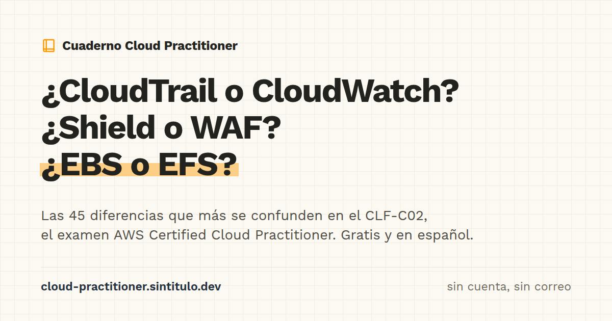

# Cuaderno Cloud Practitioner

[](https://cloud-practitioner.sintitulo.dev)

Guía estática y gratuita, en español de México, para estudiar el examen **AWS Certified Cloud Practitioner (CLF-C02)**. No requiere cuenta ni correo; tampoco rastrea entre sitios, y cada persona conserva su avance en el navegador mediante `localStorage`.

**Sitio:** [cloud-practitioner.sintitulo.dev](https://cloud-practitioner.sintitulo.dev)

## Qué encontrarás

- **45 diferencias clave:** pares de servicios o conceptos que suelen confundirse; cada entrada explica dónde está la confusión, qué ocurre en realidad y qué frase decide la respuesta.
- **Método de estudio de cuatro pasos:** analogía antes que dato, una pista por tema, bitácora de errores y simulacro con reloj.
- **Guía para el examen en línea con OnVUE de Pearson VUE:** prueba del sistema, máquinas virtuales, VPN, identificación, check-in y resultados. AWS envía el resultado en un plazo de hasta cinco días hábiles; no aparece al terminar el examen.
- **Práctica, en construcción:** se planea un banco de 240 preguntas propias, distribuido según el peso de cada dominio; incluirá diagnóstico de 20 preguntas, repaso espaciado y simulacro de 65 preguntas en 90 minutos. Aún no está disponible.

## El examen

El examen tiene 65 preguntas y dura 90 minutos; 50 preguntas cuentan para el puntaje. Se aprueba con 700 de 1000 puntos, cuesta 100 USD y está disponible en español (América Latina).

| Dominio | Peso |
| --- | ---: |
| Conceptos de la nube | 24 % |
| Seguridad y cumplimiento | 30 % |
| Tecnología y servicios | 34 % |
| Facturación, precios y soporte | 12 % |

Las preguntas del cuaderno son propias; ninguna se copia del examen real ni del set oficial de práctica de AWS. El autor, Santiago (**santiagos.mx**), todavía no ha presentado el CLF-C02; el contenido se basa en documentación oficial de AWS, verificada el 24 de septiembre de 2026, con fuente y fecha para cada dato.

Este es el segundo cuaderno de la serie. El primero preparó al autor para el examen AZ-900 de Microsoft, que presentó y aprobó; después, algunas personas que lo usaron pidieron una versión para AWS.

## Repositorio

- `site/`: sitio estático en HTML, CSS y JavaScript, sin paso de compilación; Vercel lo despliega desde esta carpeta.
- `research/`: investigación y fuentes. Incluye la logística del examen (`00-research.md`), el temario oficial con 135 puntos identificados (`01-exam-outline.md`), servicios dentro y fuera del alcance (`02-services.md`), recursos oficiales gratuitos (`03-official-resources.md`), 110 pares trampa candidatos junto con una tabla de equivalencias Azure ↔ AWS (`04-trap-pairs.md`), experiencias de la comunidad identificadas como tales (`05-community-experience.md`) y el plan (`06-plan.md`).

Para servir el sitio en local:

```bash
cd site && pnpm dlx serve .
```

Para regenerar las diferencias:

```bash
cd site && python3 generar-diferencias.py
```

## Contribuir

Se agradecen los issues que señalen errores de hechos con una cita de la documentación de AWS, así como términos en español que suenen raros.

## Aviso de marcas

Este proyecto no está afiliado a Amazon Web Services ni cuenta con su patrocinio o aval. AWS, Amazon Web Services y AWS Certified Cloud Practitioner son marcas de Amazon.com, Inc. o sus filiales.

## Licencia

Por definir.

Si te sirvió, puedes dejarle una estrella al repositorio.